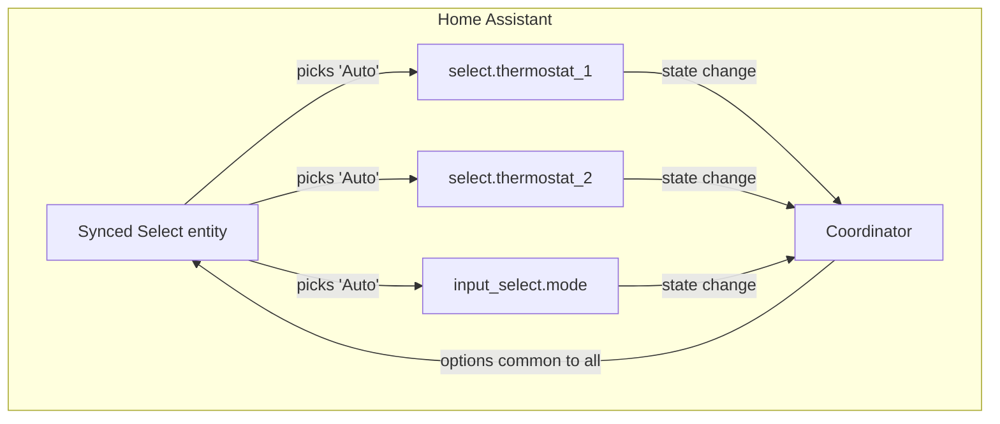

# Synced Select

A Home Assistant integration that gives you one select control that drives several
`select` and `input_select` entities at once.

Point it at a group of selects, and it creates a single "Synced Select" entity. Its
list of options is whatever those entities have in common, and picking an option sends
that choice to every one of them.

## Why you'd want this

Say you have three smart thermostats, each with a `select` for its fan mode, or a
handful of `input_select` helpers that should always march in lockstep. Normally you'd
write an automation to keep them aligned. This does that for you with one entity you can
drop on a dashboard or call from a script.

## How it works



Two things worth knowing about the behavior:

- **Options are the common set.** The synced entity only offers options that *every*
  source entity supports. If one thermostat can do `Auto`/`Low`/`High` and another only
  does `Auto`/`Low`, you'll see `Auto` and `Low`. This keeps you from sending an option
  that some entity can't accept. The list updates automatically when a source entity's
  options change.
- **It's momentary.** After you pick an option and it's been sent out, the control
  clears itself back to "unset" rather than showing a current value. It's a "push this
  to everyone" button, not a mirror of one entity's state — the source entities can
  legitimately drift apart, so there's no single value to display.

## Installation

### HACS (recommended)

1. In HACS, open the three-dot menu and choose **Custom repositories**.
2. Add `https://github.com/daredoes/synced_select` as an **Integration**.
3. Search for **Synced Select**, install it, and restart Home Assistant.

### Manual

Copy `custom_components/synced_select` into your Home Assistant `config/custom_components`
directory and restart.

## Setup

1. Go to **Settings → Devices & Services → Add Integration** and search for
   **Synced Select**.
2. Give it a **name** (this becomes the device/entity name).
3. Pick the **entities** to sync — any mix of `select` and `input_select` entities.

That's it. A new Synced Select entity appears with the shared options ready to use.

### Changing the entities later

Open the integration's **Configure** button to add or remove entities from the group.
The picker hides this integration's own entity so you can't accidentally sync it to
itself.

## Using it

Select an option however you like — from the dashboard, or in an automation/script:

```yaml
service: select.select_option
target:
  entity_id: select.synced_select   # your entity's id
data:
  option: "Auto"
```

The choice is forwarded to every source entity via their own `select.select_option` /
`input_select.select_option` service.

## Contributing

Bug reports and pull requests are welcome — see [CONTRIBUTING.md](CONTRIBUTING.md).
