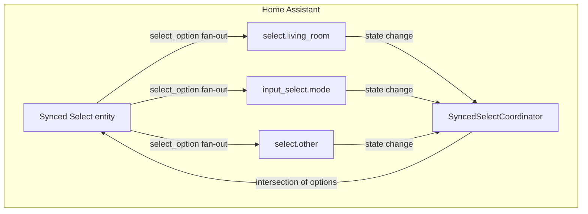

# Synced Select — Improvement Plan & Progress

> Source-of-truth progress tracker. Tick items and add notes (commit SHA / blockers)
> as work lands so the task can be resumed cheaply after a restart.

## What this integration does

`synced_select` exposes one "virtual" `select` entity that fans a chosen option out
to several underlying `select` / `input_select` entities. The options it publishes are
the **intersection** of options common to every source entity.

## Progress

| # | Item | Status | Notes |
|---|------|--------|-------|
| 1 | Progress doc (this file) | ✅ done | seeded |
| 2 | Bug 1 — listener leak (unload wiring) | ✅ done | `entry.async_on_unload(coordinator.async_unload)`; dead hook removed; regression test |
| 3 | Bug 2 — `hass.data` clobber / safe pop | ✅ done | store only coordinator; `pop(entry_id, None)` |
| 4 | Bug 3 — `_reset_state` guard | ✅ done | cancel pending reset task in `async_will_remove_from_hass` |
| 5 | Perf — debug logging + refresh simplify + `Callable` import | ✅ done | INFO→debug, removed unused imports, `Callable` under `TYPE_CHECKING` |
| 6 | Docs — humanized README + CONTRIBUTING | ✅ done | rewrote README; fixed CONTRIBUTING (ruff/mise/uv, domain) |
| 7 | Docs — `strings.json` + `translations/en.json` | ✅ done | config + options flow labels |
| 8 | Tooling — mise + uv | ✅ done | `mise.toml`, `pyproject.toml`, `uv.lock` (153 pkgs), scripts migrated; `pycares<5` constraint |
| 9 | Tests — coordinator / config_flow / select + unload regression | ✅ done | 8 tests, all green |
| 10 | Verify — lint, boot, behavior, leak, tests | ✅ done | `pytest` 8/8; ruff clean of new debt (see note) |

**Lint note:** `.ruff.toml` uses `select = ["ALL"]` (Home Assistant core's aspirational
config). 11 findings remain, all **pre-existing** strictness on original code
(missing annotations on `async_step_user`/`update_listener`/`_handle_state_change`,
type-checking-block imports). This work introduces no new lint debt. Clearing the
backlog is a separate, optional cleanup.

## Details

### Bug 1 — listener leak on unload/reload
`select.py` defines a module-level `async_unload_entry`, but HA never calls a *platform*
module's `async_unload_entry` — only the integration `__init__.py` hook runs. So
`coordinator.async_unload()` (the `async_track_state_change_event` unsubscribe) never
fires; every unload/options-edit-reload leaks a subscription.
**Fix:** in `select.py:async_setup_entry` register
`entry.async_on_unload(coordinator.async_unload)`; delete the dead
`async_unload_entry`.

### Bug 2 — hass.data clobber
`__init__.py` stores `entry.data` at `hass.data[DOMAIN][entry_id]`, then `select.py`
overwrites the same key with the coordinator. Keep only the coordinator; make unload
`pop(entry_id, None)` so it can't `KeyError`.

### Bug 3 — _reset_state race
`_reset_state` sleeps 0.25s then `async_write_ha_state()` with no guard — warns if the
entity was removed during the sleep. Guard the write (e.g. bail if not added) or cancel
the pending task on removal. The momentary-reset behavior itself is intentional and
should be documented, not removed.

### Perf / log-noise
Coordinator logs at `INFO` twice per refresh, and a refresh runs on every source state
change → downgrade to `debug`. Drop the needless `async_create_task` wrap around the
already-safe `async_request_refresh`. Import `Callable` from `collections.abc`.

### Docs
Replace the blueprint-boilerplate README with real what/why, HACS + manual install,
config/options flow walkthrough, behavior notes (intersection, momentary reset,
supported domains) and the mermaid diagram. Add `strings.json` + `translations/en.json`
so the config UI shows friendly labels instead of raw keys. Fix stale
`area_scene_state_machine` references in `CONTRIBUTING.md`.

### Tooling — mise + uv
Add `mise.toml` (`python = "3.13"`, `uv = "latest"`, tasks: setup/lint/develop/test),
`pyproject.toml` (deps migrated from `requirements.txt` + dev
`pytest-homeassistant-custom-component`), commit `uv.lock`. Migrate `scripts/*` to
`uv run` / `mise run`. Fix the stale `area_scene_state_machine` comment in
`scripts/develop`.

### Tests
`tests/` using `pytest-homeassistant-custom-component`:
- `test_coordinator.py` — intersection logic + recompute on options change + unsubscribe.
- `test_config_flow.py` — user + options flow (excludes own entity).
- `test_select.py` — fan-out service calls + momentary reset.
- Regression for Bug 1 — no refresh after unload (listeners removed).

## Verification
1. `mise install` + `mise run setup` (`uv sync`) resolve deps.
2. `mise run lint` (ruff) passes.
3. `mise run develop` boots HA; config flow shows friendly labels; entity created.
4. Two `input_select`s with overlapping options → synced entity lists only shared
   options; selecting updates both; control blanks after ~0.25s.
5. Repeated options edits → no leaked-listener growth, no `KeyError`, no INFO spam.
6. `mise run test` (`uv run pytest`) green.

## Out of scope
Open PRs #16, #36, #37, #39, #40 are Dependabot bumps — merge separately.
